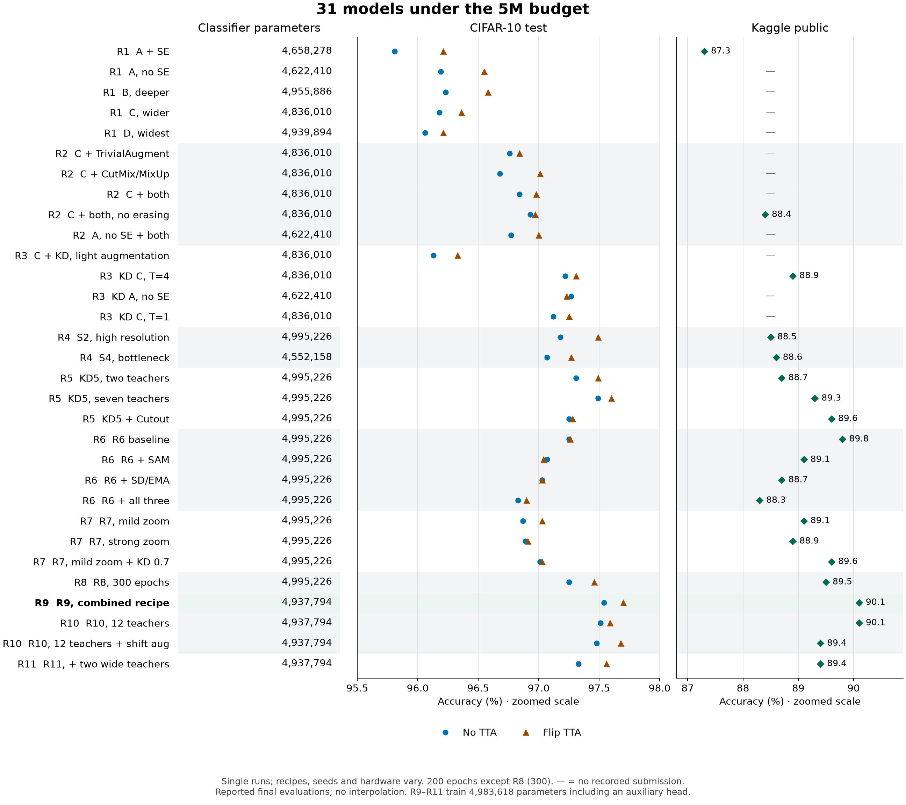
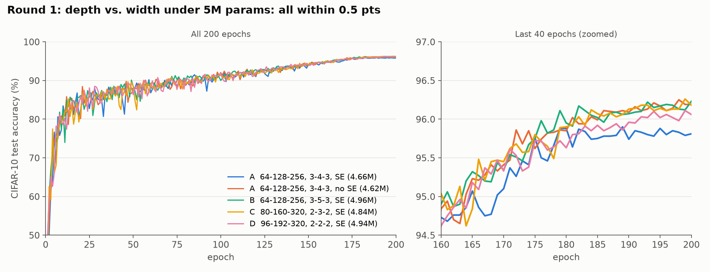
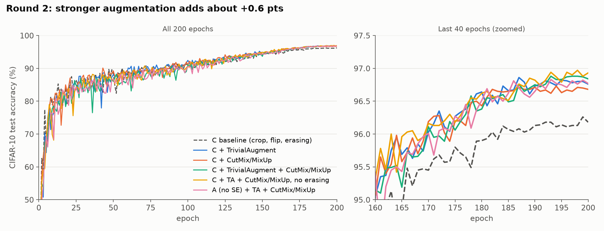
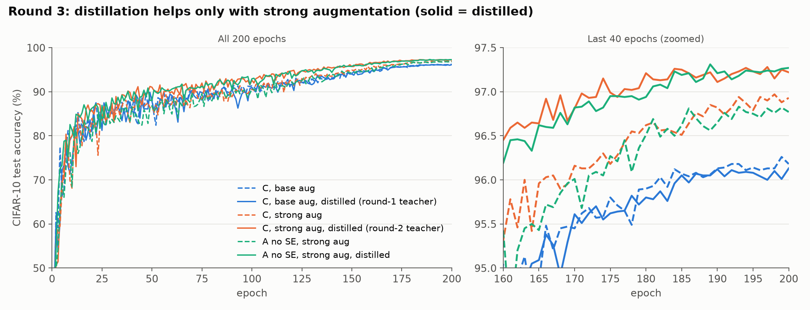
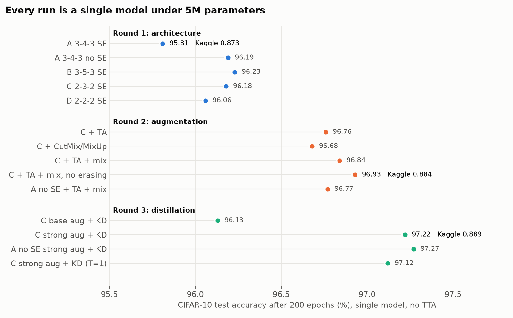
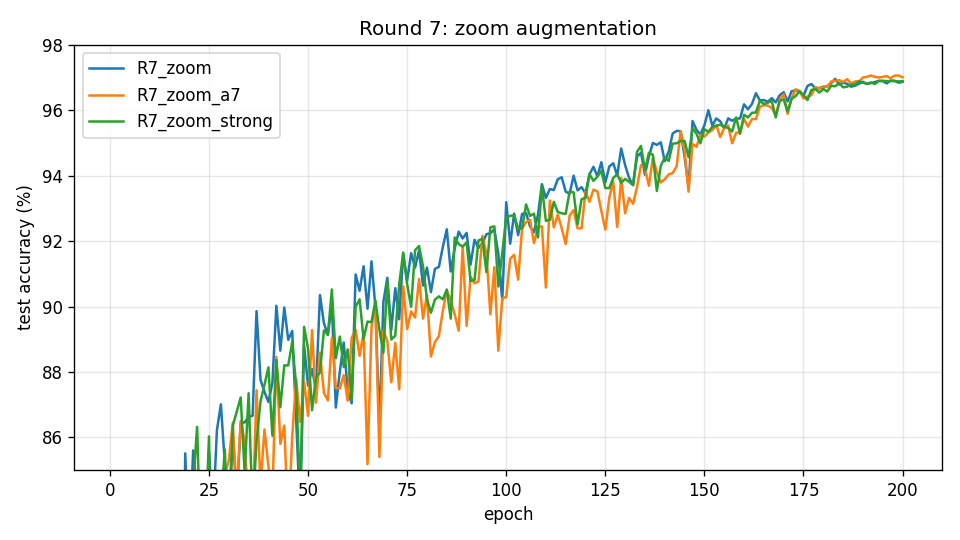
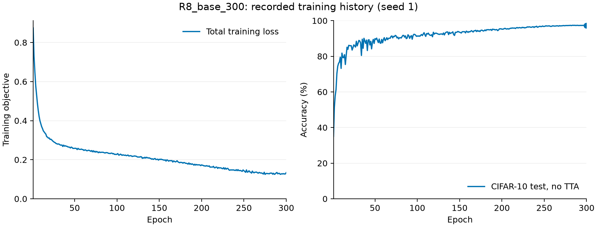
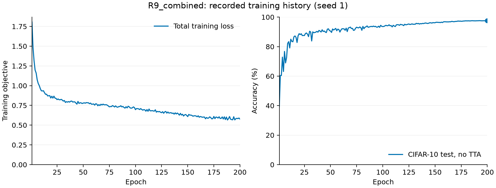

# resnet-5m

A parameter-efficient ResNet for CIFAR-10, trained from scratch under a **5M trainable-parameter budget**.

Built for the [CIFAR-10 ResNet Architecture Challenge](https://www.kaggle.com/competitions/cifar-10-res-net-architecture-challenge-dl) (NYU Tandon Deep Learning, Fall 2026): highest accuracy on a held-out image set, at most 5M trainable parameters, trained only on the 50k CIFAR-10 training images, no externally pretrained weights or external training data.

## Results

**R9_combined is our best model: 90.1% Kaggle public accuracy and 97.70% CIFAR-10 accuracy with flip averaging.** Its classifier has 4,937,794 parameters; including the contrastive head used during training, the total is 4,983,618.

We trained **31 single models across eleven rounds**, exploring architecture, augmentation, distillation, regularization, training duration and teacher strength within the same 5M budget.

| Model | Main change | Classifier params | Epochs | CIFAR-10 test | Flip TTA | Kaggle public |
|---|---|---:|---:|---:|---:|---:|
| **R9_combined** | AugMix + smaller Cutout + softer KD + contrastive loss | **4,937,794** | 200 | **97.54%** | **97.70%** | **0.901** |
| R10_t12 | R9 recipe with 12 teachers | 4,937,794 | 200 | 97.51% | 97.59% | **0.901** |
| R6_base | Ten teachers + 16px Cutout | 4,995,226 | 200 | 97.25% | 97.26% | 0.898 |
| KD5_full_cutout | Seven teachers + 16px Cutout | 4,995,226 | 200 | 97.25% | 97.28% | 0.896 |
| R8_base_300 | R6 recipe, longer cosine schedule | 4,995,226 | 300 | 97.25% | 97.46% | 0.895 |
| KD5_full | Seven teachers, no Cutout | 4,995,226 | 200 | 97.49% | 97.60% | 0.893 |



[Full model table and checkpoint links](docs/model-comparison.md) · [Chart source data](assets/experiments.json). The chart excludes teacher ensembles, 60-epoch screening runs, round 11's over-budget teachers and alternative inference settings. Missing Kaggle scores mean no recorded submission for that checkpoint and protocol. CIFAR-10 results retain each run's recorded evaluation precision; R6's later full-precision re-evaluation gives 97.26% without TTA.

### What the experiments showed

- **Architecture alone gave modest gains:** the five initial depth/width/SE configurations finished within 0.42 percentage points of each other.
- **Augmentation and distillation helped:** stronger augmentation added 0.5–0.75 points in round 2; distillation with strong augmentation added another 0.2–0.5 in round 3.
- **More training was not enough:** R8 improved flip-TTA accuracy over R6, but its Kaggle score fell from 0.898 to 0.895. The tested extra regularization and zoom recipes also fell short of R6.
- **The combined recipe performed best:** R9 reached 0.901 at 200 epochs, up 0.003 over R6. This changes several ingredients together, so it does not isolate which ingredient caused the improvement.
- **The R9 recipe then stopped improving:** two more teachers, shift-targeted augmentation and two 36.7M-parameter teachers all finished within 0.15 points of R9 on CIFAR-10 and at or below its Kaggle score. Balanced decoding of R9's predictions also scored lower.

| Round | Question | Best Kaggle public | Run |
|-------|----------|------------------------------------------|-----|
| [1](#round-1-architecture) | Depth, width and SE | 0.873 | A with SE |
| [2](#round-2-augmentation) | Stronger augmentation | 0.884 | `C_ta_mix_noerase` |
| [3](#round-3-knowledge-distillation) | Ensemble distillation | 0.889 | `KD_C_aug` |
| [4](#round-4-architecture-under-strong-augmentation) | Architecture with strong augmentation | 0.886 | `S4_deep` |
| [5](#round-5-distill-into-the-s2-architecture) | More teachers and Cutout | 0.896 | `KD5_full_cutout` |
| [6](#round-6-regularization-screen) | SAM, EMA and stochastic depth | 0.898 | `R6_base` |
| [7](#round-7-zoom-augmentation) | Zoom and distillation weight | 0.896 | `R7_zoom_a7` |
| [8](#round-8-training-duration) | 200 vs. 300 epochs | 0.895 | `R8_base_300` |
| [9](#round-9-combined-data-focused-recipe) | Combined data-focused recipe | **0.901** | `R9_combined` |
| [10](#round-10-twelve-teachers-and-shift-augmentation) | Twelve teachers and shift augmentation | **0.901** | `R10_t12` |
| [11](#round-11-wide-teachers) | Wide teachers above the student budget | 0.894 | `R11_wide` |

Each configuration has one recorded seed. Recipes, teachers and hardware vary across rounds; the tables describe these experiments rather than establish universal rankings of training methods. Kaggle scores are public scores; the private leaderboard determines the final ranking.

## Model weights

Clone the repository and run the best model:

```bash
uv sync
uv run python evaluate.py weights/R9_combined.pt       # 97.70% with flip TTA
uv run python predict.py --checkpoint weights/R9_combined.pt --out submission.csv
```

Evaluation downloads CIFAR-10 automatically. Prediction needs the competition files in `data/kaggle/`; see [Kaggle notes](#kaggle-notes). Earlier baselines, the R8 duration experiment and round 10's `R10_t12` are also included in `weights/`.

| Release | Rounds | Models | Contents |
|---|---|---:|---|
| [v0.3](https://github.com/buddhsen-tripathi/resnet-5m/releases/tag/v0.3) | 8–9 | 2 | R8's 300-epoch experiment and R9's best-scoring combined recipe |
| [v0.2](https://github.com/buddhsen-tripathi/resnet-5m/releases/tag/v0.2) | 4–7 | 12 | Architecture, teacher count, regularization and zoom experiments |
| [v0.1](https://github.com/buddhsen-tripathi/resnet-5m/releases/tag/v0.1) | 1–3 | 14 | Initial architecture, augmentation and distillation experiments |

```bash
gh release download v0.3 -p '*.pt' -D checkpoints     # the two latest models
gh release download v0.2 -p '*.pt' -D checkpoints     # rounds 4–7
gh release download v0.1 -p '*.pt' -D checkpoints     # rounds 1–3
```

Each file is named after its run and contains the student weights and model configuration (~19–20 MB). These exports load in `evaluate.py`, `predict.py` and as distillation teachers (`--teacher`); resuming requires a full training checkpoint with optimizer state. R9's training-only projection head is omitted from its inference export. The exact R8/R9 Kaggle exports and SHA-256 checksums are recorded in [`weights/round8-9.json`](weights/round8-9.json), also attached to v0.3, and R10_t12's in [`weights/round10.json`](weights/round10.json). Round 10–11 checkpoints are not yet release assets; checksums for R11 and its two wide teachers are in [`logs/11-wide-teachers/vm-manifest.sha256`](logs/11-wide-teachers/vm-manifest.sha256). The 60-epoch architecture screens are not release assets.

[v0.3 release notes](docs/releases/v0.3.md) include the two run summaries, inference commands and checkpoint limitations.

## Usage

```bash
uv sync
uv run python train.py --out checkpoints/model.pt   # downloads CIFAR-10 to data/
uv run python evaluate.py weights/R6_base.pt weights/KD_C_aug.pt   # each model and their ensemble
uv run python train.py --teacher weights/R6_base.pt --out checkpoints/student.pt
uv run python predict.py --checkpoint checkpoints/student.pt
```

`predict.py` reads `data/kaggle/test.csv` and `data/kaggle/test_images/`, averages each image with its horizontal flip (`--shift 1` also averages over 1-pixel translations and `--zoom 0.8 1.25` over scale factors; `evaluate.py` takes the same flags), and writes `submission.csv` (`id,label`). Checkpoints store the model config, so any run can be loaded without extra flags. `train.py --resume` continues from the `--out` checkpoint after an interruption; repeat the original architecture and training arguments with `--resume` added. The checkpoint must contain optimizer and scheduler state. CUDA, Apple MPS and CPU are selected automatically in that order; a CUDA GPU is recommended for the full experiments.

The default `train.py` command reproduces the original A architecture and baseline recipe. The best submitted model uses a slightly narrower S2 architecture and ten teachers; see the complete [round 9 command](#round-9-combined-data-focused-recipe). For Colab, use the notebooks linked in each round; for NYU HPC, see [`hpc/README.md`](hpc/README.md).

## Model

A configurable pre-activation ResNet with optional squeeze-and-excitation (SE) and ResNet-D shortcuts:

- **Pre-activation blocks** (BN-ReLU-conv x2, He et al. 2016): the skip path stays a pure identity, so gradients reach early layers unchanged.
- **SE channel attention**, when enabled, in every block (Hu et al. 2018): global context reweights channels for <1% extra parameters.
- **ResNet-D downsampling shortcut** (2x2 avg-pool then 1x1 conv, He et al. 2019): pooling aggregates each 2x2 region before projection.
- 3x3 stem, final BN-ReLU, global average pooling, linear classifier. Kaiming init. Input normalization lives inside the model.

Widths, blocks per stage and block type are configurable (`--widths`, `--blocks`, `--no-se`, `--block bottleneck`); each stage after the first halves the resolution (32 -> 16 -> 8). `train.py` refuses any configuration over 5M trainable parameters, including the optional contrastive projection head. `--allow-over-budget` lifts the check for teachers only, as in round 11; such checkpoints are never submission candidates.

| config | block type | widths | blocks | SE | params |
|--------|------------|--------|--------|----|--------|
| A (CLI default) | basic | 64-128-256 | 3-4-3 | yes | 4,658,278 |
| A, no SE | basic | 64-128-256 | 3-4-3 | no | 4,622,410 |
| B | basic | 64-128-256 | 3-5-3 | yes | 4,955,886 |
| C | basic | 80-160-320 | 2-3-2 | yes | 4,836,010 |
| D | basic | 96-192-320 | 2-2-2 | yes | 4,939,894 |
| S2 (`R6_base`, `KD5_full`) | basic | 128-192-232 | 4-3-2 | no | 4,995,226 |
| S4 | bottleneck | 256-448-640 | 7-7-4 | yes | 4,552,158 |
| R9 | basic | 128-192-228 | 4-3-2 | no | 4,937,794 |

`R6_base` uses S2 without SE, stochastic depth, EMA or SAM. Its training recipe adds TrivialAugment, CutMix/MixUp on half the batches, Cutout and flip-averaged distillation from ten teachers (temperature 4, distillation weight 0.9).

## Training recipe

The latest three runs share SGD with momentum 0.9 and Nesterov, batch size 256, initial learning rate 0.2, five warmup epochs, cosine decay, weight decay 5e-4 and ten frozen teachers trained by us. Their differences are:

| Setting | R6_base | R8_base_300 | R9_combined |
|---|---|---|---|
| Epochs | 200 | 300 | 200 |
| Stage widths / blocks | 128-192-232 / 4-3-2 | Same as R6 | 128-192-228 / 4-3-2 |
| Image augmentation | TrivialAugment | TrivialAugment | AugMix |
| CutMix/MixUp probability | 0.5 | 0.5 | 0.5 |
| Cutout square | 16×16 | 16×16 | 8×8 |
| Distillation weight / temperature | 0.9 / 4 | 0.9 / 4 | 0.7 / 4 |
| Label smoothing | 0.1 | 0.1 | 0 |
| Supervised contrastive loss | Off | Off | Weight 0.1, temperature 0.07 |
| Seed | 1 | 1 | 1 |

[Training commands for all eleven rounds](docs/training.md) include the complete flags and teacher lists. `train.py --help` documents the available options. Training writes checkpoints atomically after every epoch and uses mixed precision on CUDA.

Only the 50k CIFAR-10 training images contribute gradient updates. The official 10k test split is monitored after each epoch and has informed experiment choices, so it is not an independent final assessment of the selected recipe. The saved checkpoint is the final epoch, not the epoch with the highest observed score.

## Experiments

Rounds 1-7 and 9-11 use **200 epochs** for full student runs; round 8 tests **300 epochs**, and round 11's teachers train for 250. Round 4 first screens candidates for 60 epochs, then trains the selected architectures from scratch for 200; the screening and confirmation results are reported separately. Rounds 1-4 use seed 0; rounds 5-11 use seed 1 for students. Hardware, worker counts and teacher sets also vary across rounds, so comparisons across rounds do not isolate a single change.

Rounds 1-3 ran on one NVIDIA B300, with full per-epoch logs in [`logs/`](logs). Rounds 4-7 used Colab A100 notebooks in [`notebooks/`](notebooks); only round 7's per-epoch logs are currently committed alongside the round 1-3 logs. The notebooks embed the model and training code used for their experiments.

Round 10 ran on a Colab A100 notebook with per-epoch logs in [`logs/10-shift/`](logs/10-shift/). Rounds 8-9 and 11 ran on one H200. Their logs include the runtime package versions, recipe manifests, full-precision evaluation and Kaggle submission records. Recreate their unsmoothed training curves with `uv run --no-project --with matplotlib python scripts/plot_training.py`, or the all-model comparison with `uv run --no-project --with matplotlib python scripts/plot_experiments.py`. Matplotlib is only needed for plotting.

*Final* is test accuracy after the last epoch, *best* is the highest observed epoch, and *TTA* is the final checkpoint averaged with its horizontal flip (`evaluate.py`). CIFAR-10 values are percentages; Kaggle scores are fractions. Training evaluation uses CUDA mixed precision, while `evaluate.py` uses full precision, so small differences between devices or evaluation paths are possible.

Commands below use shell arrays and work in Bash and Zsh. Each round defines its own arguments. Download the required teacher checkpoints from the releases before running distillation.

### Round 1: architecture

How to spend 5M parameters: deeper (B) vs. wider (C, D), and whether SE helps (A with/without).

[Training commands](docs/training.md#round-1-architecture)

| run | widths | blocks | SE | params | final | best | TTA |
|-----|--------|--------|----|--------|-------|------|-----|
| A | 64-128-256 | 3-4-3 | yes | 4,658,278 | 95.81 | 95.90 | 96.21 |
| A | 64-128-256 | 3-4-3 | no | 4,622,410 | 96.19 | 96.25 | 96.55 |
| B | 64-128-256 | 3-5-3 | yes | 4,955,886 | **96.23** | 96.23 | **96.58** |
| C | 80-160-320 | 2-3-2 | yes | 4,836,010 | 96.18 | **96.26** | 96.36 |
| D | 96-192-320 | 2-2-2 | yes | 4,939,894 | 96.06 | 96.11 | 96.21 |
| ensemble of the 5 | | | | | | | 97.06 |



- All five land within 0.42 pts. Depth vs. width barely matters at this budget.
- A with SE finished lowest, but B, C and D (all with SE) match A without SE, so with one seed per config the SE effect is indistinguishable from run-to-run noise.
- Flip TTA adds 0.15-0.4 pts to every model.
- Kaggle public score of A (SE): **0.873**, about 8.5 points below its CIFAR-10 test accuracy, suggesting a distribution shift between the two evaluation sets.

### Round 2: augmentation

Same budget, stronger regularization: TrivialAugment (per-image), CutMix/MixUp (per-batch, half the batches), and whether random erasing is still useful on top.

[Training commands](docs/training.md#round-2-augmentation)

| run | augmentation | params | final | best | TTA |
|-----|--------------|--------|-------|------|-----|
| C | baseline (round 1) | 4,836,010 | 96.18 | 96.26 | 96.36 |
| C | + TrivialAugment | 4,836,010 | 96.76 | 96.86 | 96.84 |
| C | + CutMix/MixUp | 4,836,010 | 96.68 | 96.73 | **97.01** |
| C | + both | 4,836,010 | 96.84 | 96.88 | 96.98 |
| C | + both, no erasing | 4,836,010 | **96.93** | **96.97** | 96.97 |
| A (no SE) | + both | 4,622,410 | 96.77 | 96.83 | 97.00 |
| ensemble of the 5 | | | | | 97.50 |



- Every augmentation setting beats its baseline by 0.5-0.75 pts at the same 200 epochs; combining TrivialAugment with CutMix/MixUp is best.
- Strong augmentation trains slower early (lower accuracy until ~epoch 150) and catches up once the learning rate decays.
- Random erasing on top of both is neutral.
- Kaggle public score of C + both, no erasing: **0.884** (+1.1 over round 1).

### Round 3: knowledge distillation

The ensembles are better than any single model but are 5x over the budget. Distillation moves that accuracy into one model under 5M: the student is trained on the averaged logits of the teacher ensemble, computed on the same augmented batch it sees. Teachers are our own models trained from scratch on the same data, as the rules allow.

[Training commands](docs/training.md#round-3-knowledge-distillation)

| run | augmentation | teacher | KD loss | params | final | best | TTA | same run without KD |
|-----|--------------|---------|---------|--------|-------|------|-----|---------------------|
| C | baseline | round 1 (97.06%) | T=4, alpha=0.9 | 4,836,010 | 96.13 | 96.13 | 96.33 | 96.18 |
| C | both, no erasing | round 2 (97.50%) | T=4, alpha=0.9 | 4,836,010 | 97.22 | 97.28 | **97.31** | 96.93 |
| A (no SE) | both, no erasing | round 2 (97.50%) | T=4, alpha=0.9 | 4,622,410 | **97.27** | **97.31** | 97.23 | 96.77 |
| C | both, no erasing | round 2 (97.50%) | T=1, alpha=1.0 | 4,836,010 | 97.12 | 97.15 | 97.25 | 96.93 |



- With baseline augmentation, distillation gives nothing (96.13 vs. 96.18): its early lead disappears once the learning rate decays.
- With strong augmentation and the stronger teacher it adds +0.2 to +0.5 pts, pushing a single sub-5M model past 97.2%. This round changes both augmentation and teacher quality relative to the baseline distillation run.
- Softened (T=4) vs. raw (T=1) teacher targets are within noise.
- Flip TTA has a smaller or negative effect on these distilled students; its benefit depends on the checkpoint.
- Kaggle public score of the distilled C: **0.889** (+0.5 over round 2).



### Round 4: architecture under strong augmentation

Round 1 compared architectures with weak augmentation. This round repeats the search with TrivialAugment and CutMix/MixUp, including higher-resolution stages and bottleneck blocks. Five candidates were screened for 60 epochs ([`notebooks/round4_screening.ipynb`](notebooks/round4_screening.ipynb)), and the top two were confirmed for 200 ([`notebooks/round4_confirm.ipynb`](notebooks/round4_confirm.ipynb)).

[Training commands](docs/training.md#round-4-architecture-under-strong-augmentation)

| run | block | widths | blocks | SE | params | 60 epochs (final) | 60 epochs (best) | 200 epochs (final) | TTA | Kaggle |
|-----|-------|--------|--------|----|--------|-------------------|------------------|--------------------|-----|--------|
| S0_C | basic | 80-160-320 | 2-3-2 | yes | 4,836,010 | 95.39 | 95.50 | | | |
| S1_mid | basic | 96-168-232 | 3-3-3 | yes | 4,786,532 | 95.64 | 95.67 | | | |
| S2_highres | basic | 128-192-232 | 4-3-2 | no | 4,995,226 | **95.90** | **95.93** | **97.18** | **97.49** | 0.885 |
| S3_bneck | bottleneck | 256-512-768 | 5-5-3 | yes | 4,529,290 | 95.42 | 95.46 | | | |
| S4_deep | bottleneck | 256-448-640 | 7-7-4 | yes | 4,552,158 | 95.89 | 95.93 | 97.07 | 97.27 | **0.886** |

- Without any teacher, S2 nearly matches the distilled C on CIFAR-10 test (97.18 vs. 97.22) and beats it with flip TTA (97.49 vs. 97.31).
- Neither model beats the distilled C on Kaggle (0.889), so better CIFAR-10 accuracy did not carry over here.
- Differences of a few thousandths are close to the noise of the public leaderboard, which scores only part of the 2,000 test images.

### Round 5: distill into the S2 architecture

S2 is the best architecture without KD, so it became the student. The teachers are now our own models from rounds 2-4, averaged over the horizontal flip (`--teacher-flip`). `KD5_pair` uses S2 and the distilled C, while the other two runs use seven teachers. The notebook is [`notebooks/round5_kd.ipynb`](notebooks/round5_kd.ipynb).

[Training commands](docs/training.md#round-5-distill-into-the-s2-architecture)

| run | teachers | Cutout | params | final | TTA | Kaggle |
|-----|----------|--------|--------|-------|-----|--------|
| KD5_pair | 2 | no | 4,995,226 | 97.31 | 97.49 | 0.887 |
| KD5_full | 7 | no | 4,995,226 | **97.49** | **97.60** | 0.893 |
| KD5_full_cutout | 7 | yes | 4,995,226 | 97.25 | 97.28 | **0.896** |

- Seven teachers beat two on both measures: +0.18 pts on CIFAR-10 test and +0.006 on Kaggle.
- Both seven-teacher students beat the previous best of 0.889 on Kaggle.
- Cutout lowers CIFAR-10 test accuracy by 0.24 pts but scores 0.003 higher on Kaggle, about 3 images on the public leaderboard. With one seed, that is too small to call either way.

### Round 6: regularization screen

Ten teachers (the seven from round 5, plus S4, KD5_full and KD5_full_cutout), with Cutout on every run. The notebook is [`notebooks/round6_screen.ipynb`](notebooks/round6_screen.ipynb).

[Training commands](docs/training.md#round-6-regularization-screen)

| run | added | params | final | best | TTA | Kaggle |
|-----|-------|--------|-------|------|-----|--------|
| R6_base | none | 4,995,226 | **97.25** | **97.27** | **97.26** | **0.898** |
| R6_sam | SAM | 4,995,226 | 97.07 | 97.17 | 97.04 | 0.891 |
| R6_sd_ema | stochastic depth, EMA | 4,995,226 | 97.03 | 97.03 | 97.03 | 0.887 |
| R6_all | all three | 4,995,226 | 96.83 | 96.86 | 96.90 | 0.883 |

- SAM and the combined stochastic-depth/EMA setting each lowered both CIFAR-10 accuracy and the Kaggle score; stacking all three was worst. This is consistent with excessive regularization in this 200-epoch recipe. Stochastic depth and EMA were not tested separately.
- R6_base scores +0.002 over KD5_full_cutout on Kaggle at identical final accuracy (97.25), which is within leaderboard noise.
- Flip plus 1-pixel shift TTA left KD5_full_cutout at 0.896.

### Round 7: zoom augmentation

Many of the hidden images our models are least sure about show tiny objects, close-ups or unusual scenes. This round tests whether random zoom helps, along with a softer KD weight. The notebook is [`notebooks/round7_zoom.ipynb`](notebooks/round7_zoom.ipynb), and the per-epoch logs are in [`logs/7-zoom`](logs/7-zoom).

[Training commands](docs/training.md#round-7-zoom-augmentation)

| run | zoom | KD alpha | params | final | best | TTA | Kaggle |
|-----|------|----------|--------|-------|------|-----|--------|
| R6_base | none | 0.9 | 4,995,226 | **97.25** | **97.27** | **97.26** | **0.898** |
| R7_zoom | 0.75-1.33 | 0.9 | 4,995,226 | 96.87 | 96.96 | 97.03 | 0.891 |
| R7_zoom_strong | 0.5-1.5 | 0.9 | 4,995,226 | 96.89 | 96.90 | 96.91 | 0.889 |
| R7_zoom_a7 | 0.75-1.33 | 0.7 | 4,995,226 | 97.01 | 97.06 | 97.03 | 0.896 |



- The tested random-zoom settings lowered both CIFAR-10 accuracy and the Kaggle score relative to `R6_base`. They did not resolve the gap between evaluation sets.
- Zoom TTA on R6_base also hurt, scoring 0.883.
- With mild zoom, the softer KD weight added 0.14 pts on CIFAR-10 and +0.005 on Kaggle. That is suggestive, but one seed cannot separate it from leaderboard noise.

### Round 8: training duration

The `R6_base` recipe was trained from scratch for 300 epochs, with its cosine schedule extended across all 300. Architecture, ten teachers, augmentation and seed 1 were retained. The run used one H200, took 82.74 minutes of epoch time, and resumed from epoch 113 after the VM was stopped. Full logs and runtime details are in [`logs/8-duration/`](logs/8-duration/).

[Training commands](docs/training.md#round-8-training-duration)

| run | epochs | no TTA | flip TTA | Kaggle public |
|-----|--------|--------|----------|---------------|
| R6_base | 200 | 97.26 | 97.26 | **0.898** |
| R8_base_300 | 300 | 97.25 | **97.46** | 0.895 |

Both checkpoints were re-evaluated in full precision on the H200 for this table; the original mixed-precision training evaluation reports R6_base at 97.25%. The additional epochs improved flip-TTA accuracy by 0.20 percentage points, but did not improve the public Kaggle score. This is one run on different hardware/software from the original Colab baseline, not evidence that longer training never helps.



### Round 9: combined data-focused recipe

One combined 200-epoch experiment, rather than separate ablations: 8x8 Cutout, KD weight 0.7, no label smoothing, AugMix transforms replacing TrivialAugment, and supervised contrastive loss with weight 0.1 and temperature 0.07. It uses the same ten frozen teachers as round 6 and seed 1. AugMix is used as an image transform; there is no separate AugMix Jensen-Shannon consistency penalty.

The last stage is narrowed from 232 to 228 channels so the 128-dimensional, two-layer contrastive projection head fits the budget. The classifier has **4,937,794 parameters**, the projection head **45,824**, and all trainable parameters total **4,983,618**. Teachers are frozen and the projection head is unused during inference.

[Training commands](docs/training.md#round-9-combined-data-focused-recipe)

The contrastive objective uses the original class labels and two unmixed views; classification and distillation use the potentially mixed batch. New checkpoints retain the projection head, optimizer, scheduler and main-process CPU/CUDA RNG states for resuming. Persistent data-loader workers' augmentation streams are not restored bit-for-bit after interruption.

Training completed all 200 epochs on one H200. Full-precision evaluation reached **97.54% without TTA** and **97.70% with horizontal-flip averaging**, compared with 97.26%/97.26% for R6_base and 97.25%/97.46% for R8_base_300 in the same evaluation. The flip-averaged R9 submission scored **0.901 on Kaggle public**, beating R6_base's 0.898 by 0.3 percentage points (three additional correct predictions on the 1,000-image public split). Results, submission metadata and runtime records are in [`logs/9-combined/`](logs/9-combined/). The combined experiment cannot attribute any gain or loss to an individual change.

| run | no TTA | flip TTA | Kaggle public |
|-----|--------|----------|---------------|
| R6_base | 97.26 | 97.26 | 0.898 |
| R8_base_300 | 97.25 | 97.46 | 0.895 |
| R9_combined | **97.54** | **97.70** | **0.901** |



The curves show unsmoothed per-epoch mixed-precision evaluation without TTA. R9's total loss includes the contrastive term, so its loss magnitude is not directly comparable with R8's.

### Round 10: twelve teachers and shift augmentation

Two R9-recipe students, seed 1, 200 epochs, distilled from **12 teachers**: R9's ten plus R8_base_300 and R9_combined. `R10_shift` also adds two transforms aimed at the hidden images, which are slightly brighter, higher-contrast and sharper than CIFAR-10: resampling (upscale to 48–64 pixels and back with random filters, `--resample 0.5`) and brightness/contrast jitter 0.2 on half the images (`--jitter 0.2`). Both ran side by side on one Colab A100 in [`notebooks/round10_shift.ipynb`](notebooks/round10_shift.ipynb), at about 124 s per epoch each. Logs, flip-TTA evaluation and submission records are in [`logs/10-shift/`](logs/10-shift/).

[Training commands](docs/training.md#round-10-twelve-teachers-and-shift-augmentation)

| run | change from R9 | final | best | flip TTA | Kaggle public |
|-----|----------------|-------|------|----------|---------------|
| R9_combined | none | **97.54** | **97.57** | **97.71** | **0.901** |
| R10_t12 | 12 teachers | 97.51 | 97.51 | 97.59 | **0.901** |
| R10_shift | 12 teachers + resampling + jitter | 97.48 | 97.54 | 97.68 | 0.894 |
| ensemble of the 3 | | | | 97.85 | |

- Neither change beat R9. All three are within 0.12 points with flip TTA, which is within the expected run-to-run noise of a single seed.
- R10_t12 ties R9 on Kaggle while disagreeing with it on 82 of the 2,000 hidden images, so the two are useful as different final submissions.
- The shift augmentation kept CIFAR-10 accuracy but scored 0.007 lower on Kaggle, about 1 paired standard deviation; it did not close the gap between the two evaluation sets.
- R9's flip-TTA value here is from the same Colab evaluation; the round 9 H200 evaluation gives 97.70.

### Round 11: wide teachers

The two largest gains so far came from distillation in rounds 3 and 5, so this round strengthens the teachers. It trains two **36.7M-parameter** teachers, then the exact R9 student with them added to its ten teachers. The teachers use our pre-activation ResNet at WideResNet-28-10 scale (widths 160-320-640, four blocks per stage, no SE), round 2 augmentation and no distillation, 250 epochs, seeds 1 and 2. Only the submitted student is bound by the 5M limit; `--allow-over-budget` admits the teachers and prints a warning that they must not be submitted. Everything ran on one H200: the two teachers side by side in about 47 minutes each, then the student at 26.7 s per epoch for 89 minutes. Logs, the runner, the environment record and the checksum manifest are in [`logs/11-wide-teachers/`](logs/11-wide-teachers/).

[Training commands](docs/training.md#round-11-wide-teachers)

| run | params | final | best | flip TTA | Kaggle public |
|-----|--------|-------|------|----------|---------------|
| T_wide_s1 (teacher) | 36,688,170 | 97.63 | 97.68 | 97.86 | not eligible |
| T_wide_s2 (teacher) | 36,688,170 | **97.65** | **97.76** | 97.85 | not eligible |
| R9_combined | 4,937,794 | 97.54 | 97.57 | **97.70** | **0.901** |
| R11_wide | 4,937,794 | 97.33 | 97.40 | 97.56 | 0.894 |
| ensemble of R9, R11 and both teachers | | | | 98.05 | |

- Both wide teachers are the most accurate single models we trained, but the student did not follow: R11 finished 0.14 points below R9 with flip TTA and 0.007 lower on Kaggle.
- With rounds 8 and 10, this suggests the R9 student recipe is saturated near 97.6–97.7% flip TTA; neither more epochs, more teachers nor stronger teachers improved it.

**Balanced decoding.** The hidden set has 200 images per class, while R9's predictions range from 174 airplanes to 221 automobiles. [`scripts/balance.py`](scripts/balance.py) keeps the model unchanged and reassigns predictions so that each class receives exactly 200, choosing the assignment with the highest total log-probability (prior correction under label shift, Saerens et al. 2002). On 25 balanced 2,000-image subsets of CIFAR-10 test it changed about 17 predictions and moved accuracy by +0.04 points on average (−0.35 to +0.35). On the hidden set it changed 68 of R9's 2,000 predictions and scored **0.893**, below R9's 0.901, so it was not used further. The record is in [`logs/11-wide-teachers/balanced-decoding.json`](logs/11-wide-teachers/balanced-decoding.json).

## Kaggle notes

- The test set is 2,000 32x32 PNGs plus `test.csv` (`id,filename`); 1,000 images determine the public score and 1,000 the private score. Submissions are `id,label` with CIFAR-10 class indices. These files and account credentials are not included in the repository.
- For local prediction, place `test.csv` in `data/kaggle/` and the PNGs in `data/kaggle/test_images/`, or pass the containing directory with `--data-dir`. `predict.py` writes a CSV locally; it does not submit it to Kaggle.
- Bulk download is not available for this competition, and per-file API downloads are rate-limited (HTTP 429). Predictions can instead be made inside a private Kaggle notebook with the competition data attached and the checkpoint uploaded as a private dataset, running `predict.py --data-dir <competition input dir>`.
